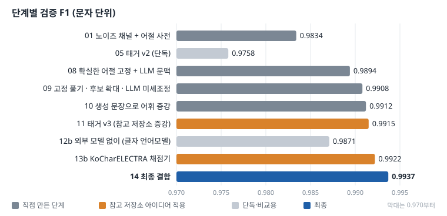

# 난독화된 한글 리뷰 복원 ― 노이즈 채널 + 문맥 재선택

> [DACON 「난독화된 한글 리뷰 복원 및 생성 AI 경진대회」](https://dacon.io/competitions/official/236446/overview/description)(종료된 대회)에 개인으로 모의 참여한 기록입니다.
> 기간: 2026.10.09 – 2026.10.11 · 형태: 개인 · 환경: Google Colab(A100)
> 결과: **Public 리더보드 0.99217**, 검증 F1 0.9834(출발점) → **0.9937**(최종)
>
> 참고한 저장소: **[SoleMin/DACON-korean_review_deobfuscator](https://github.com/SoleMin/DACON-korean_review_deobfuscator)**
> 이 저장소의 학습 증강 아이디어와 KoCharELECTRA 사용 아이디어를 가져와 제 구조에 맞게 바꿔 적용했습니다(아래 「참고 저장소에서 가져온 것」).
>
> **그림으로 한 번에 보기: [00_한눈에_보기.pdf](00_한눈에_보기.pdf)** (8쪽, 구조·아이디어·단계별 점수 정리. GitHub에서 바로 열림)



---

## 한눈에 보기

| 항목 | 내용 |
|---|---|
| 과제 | 발음이 비슷한 자모로 바꿔 쓴 숙박 리뷰를 원래 문장으로 복원 |
| 평가 | 같은 위치 글자의 일치율(문자 단위 F1). 한글 음절만 바뀌고 길이·공백·문장부호는 그대로 |
| 접근 | ① 노이즈 채널로 1차 복원 → ② 모델들이 같은 답을 낸 어절은 고정 → ③ 나머지 어절만 후보 20개 중 문맥 점수로 다시 고름 |
| 문맥 점수 | 미세조정한 Qwen2.5-1.5B, 직접 학습한 글자 언어모델, 문자 5-gram, KoCharELECTRA discriminator |
| 검증 | train 의 10%(1,126문장)를 고정 검증 분할로 두고, 모든 가중치는 여기서만 정함. test 는 train 전체로 다시 학습한 모델로 예측 |
| 외부 자원 | 외부 데이터 없음. 공개 가중치 모델 2개만 사용(Qwen2.5-1.5B, KoCharELECTRA, 둘 다 Apache-2.0) |

## 1. 문제

<sub>아래 예시는 대회 데이터가 아니라, 같은 규칙으로 직접 만든 문장입니다.</sub>

| | 문장 |
|---|---|
| 난독화 입력 | 빵위 넗꼬 쬬욯헤써 쨜 쒸얷여욥 |
| 정답 | 방이 넓고 조용해서 잘 쉬었어요 |

난독화는 글자를 아무렇게나 바꾸지 않습니다. 자음은 ㄱ·ㄲ·ㅋ처럼 비슷한 소리끼리, 모음은 ㅏ·ㅑ처럼 비슷한 모음끼리 바뀌고, 받침은 덧붙거나 빠지며, 연음(받침이 다음 글자 초성으로 넘어가는 발음)을 따라 적기도 합니다.

## 2. 구조: 한 번에 풀지 않고 3단계로

```
난독화 문장 ─▶ ① 노이즈 채널 복원 ─▶ ② 확실한 어절 고정 ─▶ ③ 나머지 어절을 문맥으로 재선택 ─▶ 복원 문장
               자모별 바뀔 확률          노이즈 채널과 태거가          후보 20개를 "난독화 유사도
               × 문자 5-gram            같은 답 → 고정(98% 이상 정확)    + 앞뒤 문맥 점수"로 다시 고름
               + 어절 사전 가점
```

### ① 노이즈 채널 + 어절 사전 (`noisy_channel.py`, 검증 0.9834)

$`y^* = \arg\max_y \; \log P_{LM}(y) + \log P_{ch}(x \mid y)`$

- **채널** $`P_{ch}(x\mid y)`$: 원래 자모가 난독화 자모로 바뀔 확률을 train 에서 셉니다. 연음은 "앞 글자 받침 + 다음 초성"을 함께 봅니다.
- **언어모델** $`P_{LM}(y)`$: train 정답으로 만든 문자 5-gram(Kneser-Ney).
- **어절 사전**: 처음 세운 아이디어는 "비슷한 자모에 같은 번호를 붙여 단순화하고, 단순화한 모양이 같은 사전 단어를 찾는다"였습니다. train 전체 어절 20만 6천 개로 번호가 난독화 뒤에도 유지되는지 세어 보니 결과가 갈렸습니다.

| 단순화 기준 | 글자 단위 유지 | 어절 전체 유지 | 그래서 |
|---|---|---|---|
| 모음 번호 (ㅏㅑ · ㅓㅕㅝ · ㅗㅛ · ㅜㅠㅡ · ㅣㅟㅢ · ㅐㅔㅖㅒㅚㅙㅞ) | 100.0% | 100.0% | 사전 검색 열쇠로 사용 |
| 자음(초성) 번호 (ㄱㄲㅋ · ㄷㄸㅌ · ㅂㅃㅍ · ㅅㅆ · ㅈㅉㅊ) | 95.8% | 86.9% | 열쇠에서 빼고 확률로만 반영 |
| 받침 | 61.4% | – | 확률로만 반영 |

자음 번호가 깨지는 경우는 거의 전부 연음입니다. 자음까지 열쇠에 넣으면 어절 8개 중 1개(13.1%)는 정답이 후보에 들어오지도 못합니다. 그래서 **깨지지 않는 모음만으로 넓게 찾고, 고를 때 자음·받침을 확률로 정밀하게 보는** 구조로 나눴습니다. 사전 후보마다 "train 빈도 × 이 단어가 이 모양으로 난독화될 확률"로 사후확률을 계산하고, "사전에 없는 단어"도 하나의 후보로 둬서 처음 보는 단어일 가능성이 크면 사전 가점이 저절로 작아지게 했습니다.

### ② 확실한 어절 고정 (`anchor_infill.py`, `tagger_v2.py`)

처음에는 "긴 어절일수록 확실하다"는 기준으로 고정했지만(0.9837), 검증해 보니 긴 어절이 오히려 더 자주 틀렸습니다. 대신 **노이즈 채널과 글자 태거(문맥을 보고 위치별 글자를 분류하는 Transformer)가 같은 답을 낸 어절**을 고정하자 98% 이상 맞았습니다. 같은 답이어도 train 에 한 번도 없던 단어면 고정을 풀었습니다(이런 어절은 90%만 맞음).

### ③ 문맥으로 재선택 (`anchor_infill.py` → `anchor_combo14.py`)

고정되지 않은 어절마다 후보(노이즈 채널 답, 태거 답, 빔 64의 상위 20개)를 문장에 끼워 점수를 매깁니다. 유사도만 보면 10위 밖인 정답이, 앞뒤 문맥이 더해지면서 1위로 올라오는 경우가 이 구조로 바로잡는 오류입니다.

```math
\text{점수} = \text{난독화 유사도} + 1.0\cdot\text{Qwen} + 0.5\cdot\text{글자 LM} + 0.5\cdot\text{5-gram} + 1.0\cdot\text{KoCharELECTRA}
```

긴 어절부터 확정하고, 확정한 어절은 다음 어절의 문맥이 됩니다. 정방향 후 역방향으로 한 번 더 훑습니다.

## 3. 단계별 결과 (검증 F1, 같은 분할)

| 노트북 | 바꾼 것 | 검증 F1 |
|---|---|---|
| – | 입력 그대로 | 0.3930 |
| [01](01_noisy_channel.ipynb) | 노이즈 채널 + 어절 사전 | 0.9834 |
| [05](05_tagger_v2.ipynb) | 태거 v2 단독 (이후 ②의 참조 모델) | 0.9758 |
| [08](08_anchor_infill.ipynb) | 확실한 어절 고정 + LLM 문맥 | 0.9894 |
| [09](09_oov_finetune.ipynb) | 사전에 없는 어절 고정 풀기 · 후보 확대 · Qwen 리뷰 미세조정 | 0.9908 |
| [10](10_lm_augment.ipynb) | 미세조정 Qwen 이 생성한 리뷰 10만 문장으로 어휘 증강 | 0.9912 |
| [11](11_final.ipynb) | 태거 v3 (참고 저장소의 증강) | 0.9915 |
| [12](12_no_llm.ipynb) | LLM·외부 모델 없이 (직접 학습한 글자 언어모델) | 0.9871 |
| [13](13_kochar_electra.ipynb) | KoCharELECTRA discriminator 채점기 (참고 저장소 아이디어) | 0.9922 |
| [14](14_combo.ipynb) | **11 + 13 결합** | **0.9937** |

11(Qwen)과 13(KoCharELECTRA)은 평균은 비슷했지만 서로 다른 문장을 맞혔습니다(13이 나은 문장 153개, 11이 나은 문장 136개). 그래서 문맥 점수를 모두 더한 14가 가장 높았습니다. 남은 오류의 89%는 train 에 없던 단어였고, 이것이 10의 어휘 증강을 시도한 이유입니다.

모든 실행의 설정과 점수는 [results/](results/)의 `*_runs.csv`, 최고 설정은 `best_*.json`에 있습니다.

## 4. 참고 저장소에서 가져온 것

[SoleMin/DACON-korean_review_deobfuscator](https://github.com/SoleMin/DACON-korean_review_deobfuscator)는 "위치별 음절 분류(1단계) → 사전학습 모델이 다시 읽고 고치기(2단계)" 구조로 0.989를 낸 저장소입니다. 여기서 두 가지 아이디어를 가져왔습니다.

| 가져온 아이디어 | 참고 저장소에서 | 이 저장소에서 바꾼 점 | 효과 |
|---|---|---|---|
| 학습 증강 (부분 복원, 관찰된 다른 난독화 형태로 치환, 이어 붙이기, 라벨 스무딩, EMA) | 1단계 복원 모델 학습 | 태거 학습에 넣고, 미세조정 Qwen 이 생성한 리뷰에 노이즈를 입힌 샘플을 더함 | 태거 단독 0.9758 → 0.9812, 전체 0.9915 |
| KoCharELECTRA | 태거 몸통(상위 층)으로 사용 | 구조상 필요한 질문이 "후보 중 어느 것이 자연스러운가"라서, ELECTRA 원래 과제인 **바뀐 글자 찾기(discriminator)** 를 그대로 후보 채점에 사용(후보 ± 3글자 구간의 logit 합) | 가장 큰 단일 개선 0.9871 → 0.9922 |

## 5. 해 보니 안 된 것

- 태거 점수를 노이즈 채널 빔 서치에 직접 더하기: 태거가 과신해서 오히려 하락
- 가린 어절을 맞히는 빈칸 채우기 모델을 처음부터 학습: 학습 신호가 부족해 0.9583 → 다음 글자 예측(글자 언어모델)으로 바꿔 해결
- 어절 빈도 가점, "애매하면 기존 답 유지" 문턱: 효과 없음
- KoCharELECTRA generator 미세조정: discriminator 와 함께 쓰면 추가 이득 없음
- Qwen 3B·72B: 라이선스 제약으로 제외

## 6. 폴더 구성

| 경로 | 내용 |
|---|---|
| `01_…ipynb` ~ `14_…ipynb` | 단계별 실험 노트북(Colab). 각 노트북 첫 셀에 목적과 이전 단계 대비 바꾼 점 |
| `noisy_channel.py` | ① 노이즈 채널, 어절 사전, 문자 5-gram |
| `neural_tagger.py`, `tagger_dict.py`, `tagger_v2.py` | 글자 태거 (v2: 사전 제안을 입력 특징으로 사용, v3 증강 포함) |
| `ensemble.py`, `stacker.py`, `lm_rerank.py` | 초기 결합 시도 (04·06·07) |
| `anchor_infill.py` | ②③ 고정 + 문맥 재선택 (Qwen 채점) |
| `lm_finetune.py`, `lm_generate.py` | Qwen2.5-1.5B LoRA 미세조정, 리뷰 생성 |
| `char_lm.py`, `infill_lm.py`, `anchor_lm12.py`, `anchor_infill12.py` | 외부 모델 없는 글자 언어모델 (12) |
| `electra13.py`, `anchor_electra13.py` | KoCharELECTRA 채점기 (13) |
| `anchor_combo14.py` | 최종 결합 (14) |
| `results/` | 실행 기록(설정·점수)과 최고 설정 |
| `docs/figures/make_figures.py` | README 그림 생성 |

## 7. 실행

1. [대회 페이지](https://dacon.io/competitions/official/236446/data)에서 데이터를 받아 `data/`에 `train.csv`, `test.csv`, `sample_submission.csv`를 둡니다. (대회 규정상 데이터와 예측 파일은 이 저장소에 넣지 않았습니다.)
2. 저장소를 구글 드라이브 `MyDrive/데이콘/난독화`에 두고, 노트북을 번호 순서로 Colab에서 실행합니다. 각 단계는 이전 단계가 `outputs/`, `outputs10/`에 남긴 모델·후보 캐시를 씁니다.
3. 단계별 스크립트는 직접 실행할 수도 있습니다.

```bash
python noisy_channel.py --mode val      # ① 검증 F1
python noisy_channel.py --mode sweep    # 가중치 탐색 → outputs/best_params.json
python noisy_channel.py --mode test     # 제출 파일
# 최종(14): 01·05·09~13 의 결과가 있어야 함
python -u lm_finetune.py --merge_only
python -u anchor_combo14.py --mode val --llm_weights 0,0.5,1.0 --base_weights 0:0,0.5:0.5 --rtd_weights 0,0.5,1.0
python -u lm_finetune.py --full --merge_only
python -u anchor_combo14.py --mode test --aug_file outputs/gen_reviews_full.txt
```

## 8. 사용한 기술

| 분류 | 도구 |
|---|---|
| 모델 | PyTorch, Hugging Face Transformers, PEFT(LoRA), Qwen2.5-1.5B, KoCharELECTRA(monologg) |
| 고전 NLP | 노이즈 채널 디코딩, 빔 서치, 문자 5-gram(Kneser-Ney), 한글 자모 분해 |
| 실험 | pandas, multiprocessing, argparse CLI, CSV 실행 기록, Google Colab(A100) |
